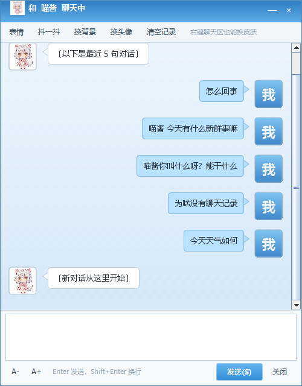

# 喵酱 · Java 猫娘桌宠 · 傻瓜部署手册

> 这份手册假设你**完全不懂 Java**。
> 从一台什么都没有的 Windows 电脑开始，照着做，10 分钟内猫娘就会坐在你的桌面右下角。
>
> 每一步都写了「**你应该看到什么**」。如果看到的和写的对不上，直接翻到 **第 8 节：出问题了看这里**。

| 项目 | 说明 |
|---|---|
| 适用系统 | Windows 10 / 11（64 位）。Win7 理论可行但没测过 |
| 需要预装 | 只要 Java 8 或更高版本（第 3 节教你装，5 分钟，不用花钱） |
| 需要联网 | **不用**。只有你想让她接真 AI 聊天时才需要（第 7 节，可选） |
| 需要数据库 | **不用**。数据存在一个本地文件里，零配置 |
| 需要管理员权限 | **不用**（便携版 Java 方案完全不需要） |
| 占用 | 约 22 MB（其中 13 MB 是 SQLite 驱动） |

---

## 0. 它是什么

一只**透明背景、悬浮在所有窗口上方**的二次元猫娘，住在桌面右下角。她不是动图，是一个真的 Java 程序：会呼吸、会走动、有情绪、能养成、能陪你学 Java。

| 模块 | 你能体验到什么 |
|---|---|
| 情绪系统 | 6 种情绪（待机 / 开心 / 害羞 / 生气 / 困倦 / 撒娇），各有独立台词和表情 |
| 互动 | 点她的**头**＝摸头，点她的**脸**＝戳脸（连戳 3 次会炸毛），按住可拖到屏幕任意位置 |
| 动作 | 疲倦（揉眼打哈欠）、摸鱼（抱着大肥鱼）、敲代码（小键盘嗒嗒响）、伸懒腰；走路有步态起伏，不再是平移滑行 |
| 养成 | 亲密度、等级、金币、每日签到、12 个成就、喂小鱼干 |
| 小游戏 | 猜数字、石头剪刀布、每日抽奖、反应力测试 |
| 智能助手 | 番茄钟（25 分钟）、待办事项、每 45 分钟休息提醒、Java 面试题自动判分（题库可自己改） |
| 聊天 | 2008 版 QQ 风格的聊天窗，能换背景换头像，记得你说过的每一句话 |

效果预览：

**全部功能界面（统一的樱花粉二次元风格：圆角卡片 + 渐变按钮 + 猫娘头像标题栏）**


**动作与动画（右键 → 动作）**


**聊天窗（2008 版 QQ 风格，可换背景和头像）**



**聊天区细节（气泡尖角、左右头像、时间条）**


**猫娘本人**


---

## 1. 三分钟速通版

如果你不想看长文，只做这三件事：

| 步骤 | 做什么 | 见到什么算成功 |
|---|---|---|
| 1 | 把整个 `java_pet` 文件夹放到 D 盘或桌面（**整个文件夹**，不是只拿 bat 文件） | 文件夹里有 `pet`、`lib`、`assets`、`out` 四个目录和三个 `.bat` |
| 2 | 双击 **`启动桌宠.bat`** | 桌面右下角出现猫娘，会上下轻轻浮动 |
| 3 | 右键点她 → 「我的猫娘（状态/成就）」 | 弹出一个状态窗口，显示等级 1、金币 0 |

**第 2 步如果弹窗说「这台电脑上没有找到 Java」**，说明还没装 Java，去第 3 节，装完回来重做第 2 步。

---

## 2. 第一步：放好文件夹

### 2.1 解压

如果拿到的是压缩包，右键 → **全部解压**（不要直接双击压缩包在里面运行，那样跑不起来）。

### 2.2 放哪儿

推荐 `D:\java_pet` 或桌面。**不要**放在 `C:\Program Files` 下面（那里需要管理员权限，SQLite 写数据会被拦）。

路径里可以有中文和空格，程序已经处理过了。

### 2.3 对照检查（这一步别跳过）

打开文件夹，必须同时看到这 7 项：

```
java_pet\
├── pet\              ← 源代码目录（必需）
├── lib\              ← 3 个 jar 依赖（必需）
├── assets\           ← 猫娘立绘（必需）
├── out\              ← 已编译好的程序（必需，有它就不用编译）
├── data\             ← 数据目录（第一次运行会自动建 pet.db）
├── 启动桌宠.bat       ← 双击这个运行
├── 重新编译.bat       ← 改了代码才用
└── 诊断启动.bat       ← 出问题了用
```

> **常见错误**：有人只把 `启动桌宠.bat` 拷到桌面，双击后毫无反应——因为程序本体在 `out` 里，图在 `assets` 里，缺一个都跑不起来。**整个文件夹一起拷**。

---

## 3. 第二步：确认电脑有没有 Java

### 3.1 一条命令自查

1. 按 **Win + R**，输入 `cmd`，回车（会弹出一个黑窗口）
2. 输入下面这行，回车：

```
java -version
```

**结果 A —— 已经装了**，看到类似这样的三行：

```
openjdk version "1.8.0_512"
OpenJDK Runtime Environment (Corretto-8.0.512.07)
OpenJDK 64-Bit Server VM (build 25.512-b07, mixed mode)
```

→ 直接跳到 **第 4 节**（版本号是 1.8、11、17、21 都可以）。

**结果 B —— 没装**，看到：

```
'java' 不是内部或外部命令，也不是可运行的程序或批处理文件。
```

→ 继续看 3.2，装一个。**不用担心装坏电脑**，下面两种方式都很安全。

### 3.2 装 Java（两种方式，任选一种）

#### 方式一：免安装便携版 —— 推荐给「不想动系统」的人

不需要管理员权限，不写注册表，不装服务，不想要了直接删文件夹。

1. 浏览器打开：<https://adoptium.net/zh-CN/temurin/releases/>
2. 按下表选择（这一步选错是最常见的坑，对照着选）：

   | 选项 | 选什么 |
   |---|---|
   | Version | **8**（选 8 最稳，体积也小） |
   | Operating System | **Windows** |
   | Architecture | **x64** |
   | Package Type | **JRE**（只是运行的话，JRE 就够；如果你还要改代码，选 JDK） |

3. 找到 `.zip` 那一行，点下载（约 40 MB）。
4. 解压出来，里面是一个文件夹，名字类似 `jdk8u452-b09-jre`。
5. **把这个文件夹改名为 `runtime`**（必须一字不差，全小写）。
6. 把 `runtime` 文件夹剪切到 `java_pet` 里面，和 `pet`、`lib`、`assets` 平排。
7. 确认这个文件真实存在：`java_pet\runtime\bin\javaw.exe`

最终结构长这样：

```
java_pet\
├── runtime\          ← 刚放进去的
│   └── bin\
│       └── javaw.exe
├── pet\
├── lib\
├── assets\
├── out\
└── 启动桌宠.bat
```

> 启动脚本会**优先**用项目里的 `runtime`，所以就算你电脑上装的是别的版本 Java，也不会冲突。

#### 方式二：安装到系统里

1. 同一个下载页，Package Type 选 **JDK**，下载 **`.msi`** 安装包。
2. 双击安装，一路 **Next**。
3. **到了选择功能的界面，务必把这两个勾上**（默认可能没勾）：

   - ☑ `Set JAVA_HOME variable`
   - ☑ `Add to PATH`

4. 装完，**关掉所有黑窗口**，重新开一个 cmd，再执行 `java -version` 验证。

### 3.3 装完再自查一次

```
java -version
```

能看到版本号就对了。**不想验证也行**——直接双击 `启动桌宠.bat`，它自己会去找 Java，找不到会停下来告诉你（不会一闪而过）。

---

## 4. 第三步：启动

双击 **`启动桌宠.bat`**。

| 你可能会看到 | 说明 |
|---|---|
| 黑窗口一闪就消失，然后猫娘出现 | ✅ **正常**。用的是 `javaw`（无控制台版本），黑框只是启动器 |
| 弹出「Windows 已保护你的电脑」 | 因为这是从网上下载的脚本。点 **更多信息 → 仍要运行**。这是 Windows 的通用拦截，不是病毒 |
| 黑窗口停住，显示「这台电脑上没有找到 Java」 | 说明 Java 没装好，回第 3.2 节 |
| 黑窗口显示「第一次运行，正在编译，大约 10 秒」 | 正常。只有 `out` 目录被删了才会编译，编完自动启动 |
| 什么都没有发生 | 用 `诊断启动.bat`（第 8 节 Q1） |

> **小知识**：程序需要"在项目文件夹里"运行，因为图片和数据库用的是相对路径。启动脚本第一行已经自动 `cd` 到自己的目录了，所以你从桌面快捷方式、从别的盘双击，都能正常跑。

---

## 5. 第四步：验收（4 个检查点）

逐条对照，**4 条全过就算部署成功**：

| # | 操作 | 应该看到 | 不符合怎么办 |
|---|---|---|---|
| 1 | 看屏幕右下角 | 一只猫娘，背景透明，正在轻轻上下浮动；过一会儿会自己慢慢走动 | 见 Q4 |
| 2 | **左键点她的头顶** | 换成撒娇/害羞表情，头顶冒出圆角气泡说一句话，约 2.6 秒后消失 | 见 Q1 |
| 3 | **右键点她** | 弹出 12 项菜单（我的猫娘 / 每日签到 / 喂小鱼干 / 小游戏 / 番茄钟 / 待办事项 / Java面试题练习 / 编辑题库 / 和猫娘聊天 / 自动游走 / 关于 / 退出） | 见 Q1 |
| 4 | 打开 `java_pet\data\` 文件夹 | 多了 `pet.db` 一个文件（几十 KB） | 见 Q6 |

**怎么关掉她**：右键 → **退出**。（不占后台、不自启、不写注册表，退出就是真的退出。）

---

## 6. 怎么玩（操作手册）

### 6.1 鼠标

| 你做什么 | 她会怎样 | 加成 |
|---|---|---|
| 左键点她**上半身（头）** | 摸头 → 撒娇或害羞 | 亲密度 +2 |
| 左键点她**下半身（脸/身子）** | 戳脸 → 害羞或生气；**10 秒内连戳 3 次必定炸毛** | 亲密度 +1 |
| 按住拖到别处 | 被拎着走，松手说一句吐槽 | 亲密度 +1 |
| 鼠标悬停在她身上 | 短暂换成开心表情 | — |
| 右键 | 功能菜单 | — |

> 判定线：立绘高度上 45% 算头，以下算脸。点错位置很正常，多点几次就找到手感了。

### 6.2 右键菜单

| 菜单项 | 作用 |
|---|---|
| 我的猫娘（状态/成就） | 看等级、亲密度、金币、连续签到天数、成就墙 |
| 每日签到 | 每天一次：亲密度 +20、金币 +10，连续签到有额外成就 |
| 喂小鱼干（20金币） | 花 20 金币换亲密度 +10 |
| 动作 | 子菜单：摸鱼（抱大肥鱼）/ 敲代码 / 疲倦 / 伸懒腰 / 回到待机；番茄钟开始时她也会自动打开键盘陪你写 |
| 小游戏 | 猜数字 / 石头剪刀布 / 每日抽奖 / 反应力测试 |
| 番茄钟（25分钟） | 25 分钟专注计时，完成 +15 亲密度 +5 金币 |
| 待办事项 | 增删待办，双击标记完成 |
| Java面试题练习 | 从 `data/quiz.txt` 抽题，答完自动判分，答对 +8 亲密度（题目可自己改，见 6.6） |
| 编辑题库（quiz.txt） | 用记事本直接打开题库文件，改完保存即生效 |
| 和猫娘聊天 | 打开 QQ 风格聊天窗 |
| 自动游走 | 勾选/取消：她会不会自己在桌面上溜达 |
| 关于 | 说一句话，介绍自己 |
| 退出 | 关掉程序 |

### 6.3 六种情绪

| 情绪 | 怎么触发 | 表现 |
|---|---|---|
| 待机 IDLE | 默认状态；其他情绪持续 1.6—4 秒后自动回落 | 呼吸浮动，偶尔自言自语复习提醒 |
| 开心 HAPPY | 鼠标悬停、抽奖中奖、猜数字险胜、面试题答错时的鼓励 | 专属立绘（比耶） |
| 害羞 SHY | 戳脸（40%）、摸头（30%）、中途放弃番茄钟 | 专属立绘（脸红捂嘴） |
| 生气 ANGRY | 戳脸（60%）、**10 秒内连戳 3 次必中**、反应测试抢跑、抽奖没中 | 待机图上叠加怒气符号 |
| 困倦 SLEEPY | **6 分钟没有任何互动**自动犯困；抽奖只抽到「谢谢参与」 | 专属立绘（打哈欠 + Zzz） |
| 撒娇 ACT_CUTE | 摸头（70%）、猜对数字、答对面试题、完成番茄钟、升级 | 待机图上叠加爱心和腮红 |

### 6.4 动作系统（她会有真实的小动作）

动作是"长时间的姿态"，情绪是"一闪而过的表情"——情绪触发时先演情绪，演完继续做手头的事。

| 动作 | 怎么触发 | 表现 |
|---|---|---|
| 待机 IDLE | 默认 | 1.2 秒一次的呼吸起伏 |
| 散步 WALK | 自动游走 / 菜单手动 | 朝行进方向转身，走路有落脚的压扁-弹起节奏，不再平移滑行 |
| 疲倦 TIRED | 坐满 45 分钟自动提醒 / 菜单演示 | 揉眼打哈欠立绘 + 呼吸变慢 + 周期性点头 |
| 摸鱼 FISHING | 闲着 3 分钟没事干自己开始（40% 概率）/ 菜单 | 抱着一条大肥鱼悠哉晃，被你摸一下就会收起来装认真 |
| 敲代码 WORKING | 番茄钟开始自动进入 / 菜单（25 分钟） | 抱着小键盘嗒嗒敲，键盘上的 `</>` 一闪一闪 |
| 伸懒腰 STRETCH | 菜单（立绘后续补，暂用疲倦图 + 大幅弹跳） | 上下大幅起伏两次 |

- 所有立绘在 `assets/cat_*.png`，缺图自动回退待机图，不会崩。
- 想加新动作：在 `pet/Act.java` 的枚举里加一项 + `art()` 里指定立绘名即可。

### 6.5 养成数值一览

| 行为 | 亲密度 | 金币 |
|---|---|---|
| 摸头 | +2 | — |
| 戳脸 / 拖动 | +1 | — |
| 每聊一句 | +2 | — |
| 游戏胜利 | +5 | 按游戏规则 |
| 番茄钟完成 | +15 | +5 |
| 面试题答对 | +8 | — |
| 每日签到 | +20 | +10 |
| 喂小鱼干 | +10 | −20 |

- **等级 = 亲密度 ÷ 100 + 1**，亲密度只涨不清零，升到 10 级要 900 点。
- 12 个成就会自动解锁并弹气泡发奖金，其中「连续签到 7 天」和「金币 500」是最难的两个。

### 6.6 自己出题（改题库，不用写代码）

题库是一个纯文本文件：**`data\quiz.txt`**。右键菜单 → **编辑题库（quiz.txt）** 就能打开（也可以自己用记事本 / VS Code 打开）。

**一行一道题，用竖线 `|` 分成三段：**

```
题目 | 参考答案 | 关键词1,关键词2,关键词3
```

举个真实例子（文件里本来就有 14 道）：

```
HashMap 链表转红黑树需要满足哪两个条件？ | 链表长度达到 8，并且 table 数组长度 ≥ 64（不满足就先扩容而不是树化）。 | 8,64,树化,红黑树
```

**判分规则**：你提交的答案里，只要**含有任意一个关键词**就算答对。所以关键词要挑"答对的人一定会说出来"的词，别挑"答错的人也可能会说"的词。

**几条实用规则：**

| 情况 | 怎么写 |
|---|---|
| 加新题 | 在文件任意位置另起一行，照上面格式写 |
| 暂时不想要某题 | 行首加 `#` 注释掉（别删，以后还能恢复） |
| 想写中文逗号 | 也行，`甲，乙；丙` 会正确拆成 3 个关键词 |
| 懒得分关键词 | 只写两段（题目 + 竖线 + 参考答案），这种题**写了答案就算对**，不判分 |
| 关键词大小写 | 不用管，`oldCap` 和 `oldcap` 效果一样 |

**改完怎么生效**：保存文件 → 回到猫娘，再点一次「Java面试题练习」（或题目窗里点「换一题」）。**不用重启桌宠**，题目窗上会显示「共 N 题 · 第 X 题」，数字变了就说明读进去了。

**改坏了会怎样**：某一行格式写错（比如漏了竖线），程序只跳过那一行并在后台窗口提示第几行，其他题照常用；整个文件一道题都读不出来，就自动退回代码里的 14 道内置题，不会白屏、不会崩。文件被误删也一样——下次点练习会自动重新生成一份带注释的模板。

> 注意：文件请保存为 **UTF-8** 编码。如果你换了编辑器，选"UTF-8"而不是"ANSI/GBK"，否则中文会变乱码。


---

## 7. 让猫娘接上真 AI（可选）

**不接也完全能聊。** 默认是离线人格：会记你的名字、记住你的喜好、按关键词回答 Java 问题、跨会话记得聊过什么。区别只是——离线版是"背台词"，接了真模型才是"真的会思考"。

### 7.1 DeepSeek 三步接入（最便宜）

1. 打开 <https://platform.deepseek.com/>，注册、登录。
2. 左侧「API keys」→ 创建，复制那串 `sk-` 开头的字符串（**只显示一次**）。
3. 在 `java_pet\data\` 下新建一个文本文件，**文件名必须是 `api_config.txt`**（注意扩展名是 `.txt`，不是 `.txt.txt`），内容三行：

```
sk-你复制的那串key
https://api.deepseek.com/v1
deepseek-flash
```

第一行 key，第二行接口地址，第三行模型名。以 `#` 开头的行会被忽略，可以留注释。

4. 重启桌宠（右键 → 退出，再双击 bat），右键 → 和猫娘聊天。

`data\api_config.txt.example` 是官方给的模板，里面有价格说明和其他服务商的地址，可以照着改。

### 7.2 花多少钱

DeepSeek 2026 年 11 月官方价（元 / 百万 tokens）：

| 模型 | 输入（未命中缓存） | 输出 | 结论 |
|---|---|---|---|
| **deepseek-flash** | 空闲 1 / 高峰 2 | 空闲 4 / 高峰 8 | ✅ 桌宠用这个 |
| deepseek-v4-pro | 空闲 4.5 / 高峰 9 | 空闲 13.5 / 高峰 27 | 猫娘用不上，别选 |

- **空闲时段（半价）**：周一至周五 9:00—12:00、14:00—18:00 **之外**的所有时间，含周末和节假日全天。
- 一轮对话大约 800 输入 + 150 输出 tokens：
  - 空闲时段 ≈ **0.0014 元/轮**，1 块钱能聊约 700 轮
  - 高峰时段 ≈ 0.0028 元/轮
- **按每天 20 轮算，一个月不到 1 块钱。** 充 10 块能用一年。

### 7.3 换成别家也行

只要服务商支持 OpenAI 格式（第二、三行换掉即可）：

| 服务商 | 第二行（接口地址） | 第三行（模型名） |
|---|---|---|
| DeepSeek | `https://api.deepseek.com/v1` | `deepseek-flash` |
| 阿里通义 | `https://dashscope.aliyuncs.com/compatible-mode/v1` | `qwen-turbo` |
| 智谱 | `https://open.bigmodel.cn/api/paas/v4` | `glm-4-flash`（有免费额度） |

### 7.4 安全提醒（重要）

`data\api_config.txt` 里是**你的私人 key，等于钱包密码**。别人拿到就能花你的钱。

- 不要把 `api_config.txt` 发给任何人，也不要上传到 GitHub
- 把项目打包发给朋友之前，**先删掉这个文件**（见附录 B）
- 万一泄露了，去服务商后台把那个 key 删掉重新建一个即可

---

## 8. 出问题了看这里

> 排查口诀：**先跑 `诊断启动.bat`**。它会把 Java 路径、工作目录、数据库位置和所有报错都打在黑窗口里，比盲猜快 10 倍。

### Q1 双击 `启动桌宠.bat`，屏幕毫无反应

按顺序试：

1. 双击 **`诊断启动.bat`**，看黑窗口里有没有红字/`Exception`。
2. 看任务管理器（Ctrl+Shift+Esc）里有没有 `javaw.exe`。有 → 她其实启动了，只是跑到屏幕外了（见 Q4）。
3. 如果黑窗口说 `没有找到 Java` → 看 Q3。
4. 如果黑窗口一闪就没了、诊断版也说没有编译产物 → 双击 **`重新编译.bat`** 看具体编译报错。

### Q2 黑窗口闪一下就消失了

**这是正常现象**，不是错误。启动器用的是 `javaw.exe`（无控制台），黑框只是启动用的壳，闪完就该出现猫娘。判断标准很简单：**猫娘在不在**。不在就用 `诊断启动.bat`。

### Q3 提示「这台电脑上没有找到 Java」

Java 没装，或者装了但没进 PATH。两个解法：

- 按第 3.2 节**方式一**做便携版（最稳，不依赖系统配置）
- 或者按方式二重装，**记得勾 `Add to PATH`**，装完必须重开黑窗口

### Q4 猫娘不见了 / 只看到半个身子 / 跑到屏幕外

程序**不保存窗口位置**，每次启动都固定在主屏右下角。所以最省事的解法是：

1. 右键 → 退出（或任务管理器结束 `javaw.exe`）
2. 重新双击 `启动桌宠.bat`

**多显示器**：她出现在 Windows 的「主显示器」右下角。想换屏，按住她拖过去就行。

**被其他窗口挡住**：她是置顶窗口，正常情况下压在所有窗口上方；个别全屏游戏/全屏视频会盖住她，退出全屏就回来。

### Q5 中文显示成方块 / 乱码

- **桌宠气泡里**是方块 → 系统缺中文字体（常见于英文版 Windows）。装一个中文字体（微软雅黑）即可。
- **黑窗口里**乱码 → 你的系统不是中文环境，`chcp 936` 一下，或者直接用 `诊断启动.bat` 看英文报错。**不影响功能**。

### Q6 提示「找不到 SQLite 驱动，请确认 lib/sqlite-jdbc-*.jar 存在」

`lib` 目录丢了或没解压完整。检查 `java_pet\lib\` 下必须有这 3 个文件：

```
sqlite-jdbc-3.44.1.0.jar    (约 13 MB)
slf4j-api-1.7.36.jar
slf4j-nop-1.7.36.jar
```

缺了就找发你文件夹的人重新要一份。

### Q7 AI 聊天报错

聊天窗会显示 `（大模型没连上喵：xxx）`，然后自动用离线人格接着聊，**不会崩**。对照错误信息：

| 提示里含 | 原因 | 解决 |
|---|---|---|
| `401` / `Unauthorized` | key 错、复制少了字符、或已被删除 | 重新复制一遍，注意别带空格 |
| `402` / `Insufficient Balance` | 账户没钱了 | 充值（几块钱够用很久） |
| `404` / `model not found` | 模型名写错，或用了已退役的 `deepseek-chat` | 第三行改成 `deepseek-flash` |
| `timed out` / `connect` | 网络问题，或公司网络限制 | 换网络；挂代理的话需要全局模式 |
| 回复是"（大模型没连上喵："+ 一大段英文 | 上面表格里找关键词 | 同上 |

### Q8 聊天记录没了

聊天记录存在 `data\pet.db`，**一条都不会删**（不是只留最近几百句）。所以：

- 换电脑 / 重装前，把 `data\pet.db` 单独复制出来，新地方放回原位即可
- 如果这个文件被删了，记录就真的没了（猫娘会从零开始认识你）
- 聊天窗首屏只显示最近 100 句，往上翻点工具栏的「**更早(N)**」按钮看全部历史

### Q9 杀毒软件报毒 / 报可疑

`.bat` 是文本脚本，且会启动一个 `javaw.exe` 进程，容易被误判。项目**不联网上传数据、不写注册表、不自启**，源码全在 `pet\` 目录里，可以自己逐行看。加白名单即可。

### Q10 任务栏上找不到她，Alt+Tab 也切不到

**设计如此**。她是一个 `UTILITY` 类型的透明悬浮窗，故意不进任务栏，免得占位置。要操作她就直接点她 / 右键她；要关掉就右键 → 退出。

### Q11 我改了 `pet` 里的代码，但没有变化

Java 改了 `.java` 必须重新编译。双击 **`重新编译.bat`**，看到「编译成功」后再双击 `启动桌宠.bat`。直接跑 `启动桌宠.bat` 不会自动重新编译（除非 `out` 目录被删了）。

### Q12 想让它开机自启

1. 按 **Win + R**，输入 `shell:startup`，回车（会打开启动文件夹）
2. 右键 `启动桌宠.bat` → **创建快捷方式**
3. 把快捷方式剪切到刚才打开的启动文件夹

下次开机她会自己出来。（不想自启了就把快捷方式删掉。）

---

## 9. 数据、备份、迁移、卸载

| 你想做的事 | 怎么做 |
|---|---|
| **备份**（保住等级和聊天记录） | 复制 `java_pet\data\pet.db` 到别处 |
| **换电脑** | 拷整个 `java_pet` 文件夹 → 新电脑装 Java → 双击 bat |
| **重置**（从 1 级重新开始） | 关掉桌宠，删掉 `data\pet.db`，重新启动（程序会自动建新库） |
| **看数据里有什么** | 用任意 SQLite 工具打开 `pet.db`，表：`pet_state`（状态）、`chat_memory`（聊天）、`sign_log`（签到）、`achievements`（成就）、`todos`（待办） |
| **卸载** | 关掉桌宠 → 删掉整个文件夹。**就这么简单**，没有服务、没有注册表、没有残留 |

> **注意**：`data\pet.db` 是整个桌宠的全部身家（亲密度、金币、成就、全部聊天记录）。删之前想清楚。

---

## 10. 目录结构（每个文件干什么）

```
java_pet\
├── 启动桌宠.bat            双击运行（自动找 Java，找不到会给提示）
├── 重新编译.bat            改过 .java 源码后重新编译
├── 诊断启动.bat            排错用，保留黑窗口显示所有日志
│
├── pet\                    源代码（17 个类）
│   ├── Pet.java            入口：窗口、呼吸动画、游走、右键菜单
│   ├── Db.java             SQLite 持久层（5 张表，全部数据）
│   ├── Emotion.java        情绪状态机（6 态 + 台词池 + 立绘切换）
│   ├── Effects.java        没有立绘时用代码叠加特效（腮红/怒气/爱心/Zzz）
│   ├── Interact.java       点击分流：摸头 / 戳脸 / 拖动
│   ├── Growth.java         养成：亲密度、等级、金币、签到、12 个成就
│   ├── StatusPanel.java    状态与成就墙窗口
│   ├── Assist.java         番茄钟、待办、45 分钟休息提醒
│   ├── QuizBank.java       Java 面试题：从 data/quiz.txt 读题 + 关键词判分
│   ├── Persona.java        AI 人格：偏好记忆、分层上下文、模型调用
│   ├── ChatPanel.java      QQ 风格聊天窗外壳（标题条/工具栏/输入区）
│   ├── ChatCanvas.java     聊天区自绘（气泡、头像、时间条、换肤）
│   └── game\               4 个小游戏 + 游戏中心
│
├── lib\                    依赖（缺一个都启动不了）
│   ├── sqlite-jdbc-3.44.1.0.jar    数据库驱动
│   ├── slf4j-api-1.7.36.jar        日志接口（驱动要）
│   └── slf4j-nop-1.7.36.jar        日志空实现（静默，不刷屏）
│
├── assets\                 素材
│   ├── cat_idle.png        待机立绘
│   ├── cat_happy.png       开心（比耶）
│   ├── cat_shy.png         害羞
│   └── cat_sleepy.png      困倦
│
├── out\                    编译产物，删了会被自动重新编译
├── data\
│   ├── pet.db              所有数据（第一次运行自动生成）
│   ├── quiz.txt            Java 面试题库（可自己改，删了会自动重建）
│   └── api_config.txt.example   AI 配置模板
└── runtime\                （可选）便携版 Java，没装 Java 时用
```

---

## 11. 想改造它（给会写代码的人）

| 想改什么 | 改哪个文件 | 关键位置 |
|---|---|---|
| 猫娘随口说的台词 | `pet/Pet.java` | `LINES` 数组（10 句待机台词） |
| 某种情绪的台词 | `pet/Emotion.java` | `lines()` 里对应 `case` |
| 情绪持续时间 | `pet/Emotion.java` | `duration()`，单位毫秒（1500—4000） |
| 摸头/戳脸的触发概率 | `pet/Interact.java` | `pokeHead()` / `pokeFace()` 里的 `RND.nextInt(100) < N` |
| 头/脸的判定线 | `pet/Interact.java` | `onClick()` 里的 `h * 0.45f` |
| 升级所需亲密度 | `pet/Growth.java` | `level()` 里的 `/ 100`；升级阈值在 `addIntimacy()` |
| 签到奖励 / 成就奖金 | `pet/Growth.java` | `sign()`、`ACH` 表 |
| 番茄钟时长 | `pet/Assist.java` | `remainSeconds = 25 * 60` |
| 休息提醒间隔 | `pet/Assist.java` | `45 * 60 * 1000` |
| 面试题库 | `data/quiz.txt` | **不用改代码**，直接改这个文本文件，见 6.6 |
| 题库读文件的逻辑 | `pet/QuizBank.java` | `load()` 读文件、`parse()` 解析、`BUILTIN` 是兜底题库 |
| 默认 AI 模型 | `pet/Persona.java` | `loadConfig()` 里的兜底值 |
| 系统人设（她怎么说话） | `pet/Persona.java` | `systemPrompt()` |
| 气泡样式 | `pet/Pet.java` | `say()` |

### 给某个情绪加一张新立绘（不用写代码）

`Emotion.assetName()` 已经约定好文件名，只要把图片按名字丢进 `assets\` 再重启即可：

| 情绪 | 需要的文件名 |
|---|---|
| 生气 | `cat_angry.png` |
| 撒娇 | `cat_actcute.png` |

要求：PNG 透明背景、约 240px 高、和现有立绘同一形象。没有对应文件时，程序会自动用代码特效（腮红、怒气符号、爱心）代替，所以不补也能用。

---

## 12. 附录

### 附录 A：Mac / Linux 怎么跑

项目里只有 Windows 的 `.bat`，但程序本身是纯 Java，交叉平台没问题。在项目根目录执行：

```bash
# 编译（只需一次）
mkdir -p out
javac -encoding UTF-8 -cp "lib/*" -d out $(find pet -name "*.java")

# 运行（注意分隔符是冒号，不是分号）
java -cp "out:lib/*" pet.Pet
```

macOS 如果是 Apple Silicon，SQLite 驱动自带 arm64 原生库，直接可用。

### 附录 B：打包发给别人之前

必须删掉这两个文件，否则等于把你的底裤送出去：

| 文件 | 里面有什么 |
|---|---|
| `data\api_config.txt` | **你的 API key（等于钱）** |
| `data\pet.db` | **你所有的聊天记录、等级、金币** |

删掉后对方第一次启动会自动重新生成空库、走离线人格。`data\api_config.txt.example` 可以留着当说明书。

还要注意打包时的取舍：

- `data\` **可以不带**，对方第一次启动会自动生成空库
- `data\quiz.txt` 想分享自己出的题就带上（就是一个文本文件，不含隐私），不带也会自动生成内置题库
- `out\` **建议带上**（这是编好的程序）。不带的话，对方必须有 JDK 才能现场编译，只有 JRE 会报「找到了运行环境但没有编译器」
- `pet\`、`lib\`、`assets\` 三个目录**一个都不能少**

### 附录 C：环境兼容性（实测记录）

| Java 版本 | 结果 |
|---|---|
| Corretto 1.8.0_512（JDK 8） | ✅ 完全正常，推荐 |
| OpenJDK 26 | ✅ 正常运行，启动时会打印几条 `native access` WARNING（SQLite 驱动的提示，不影响使用） |
| JDK 17 / 21 | 代码层面兼容（无新 API），未单独实测 |

程序本身需要 **JDK 8 及以上**：源码用了 lambda、`java.time`、`switch on enum`，都是 Java 8 的特性。

---

**部署完成后的第一件事**：右键 → 我的猫娘 → 每日签到。先拿 10 个金币，再花 20 喂条小鱼干试试手感。
